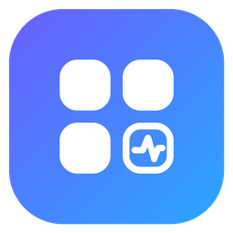
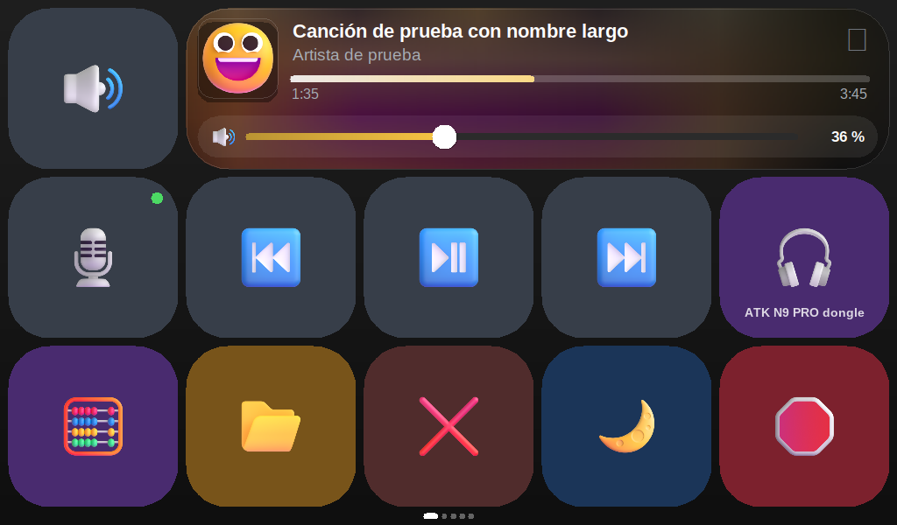
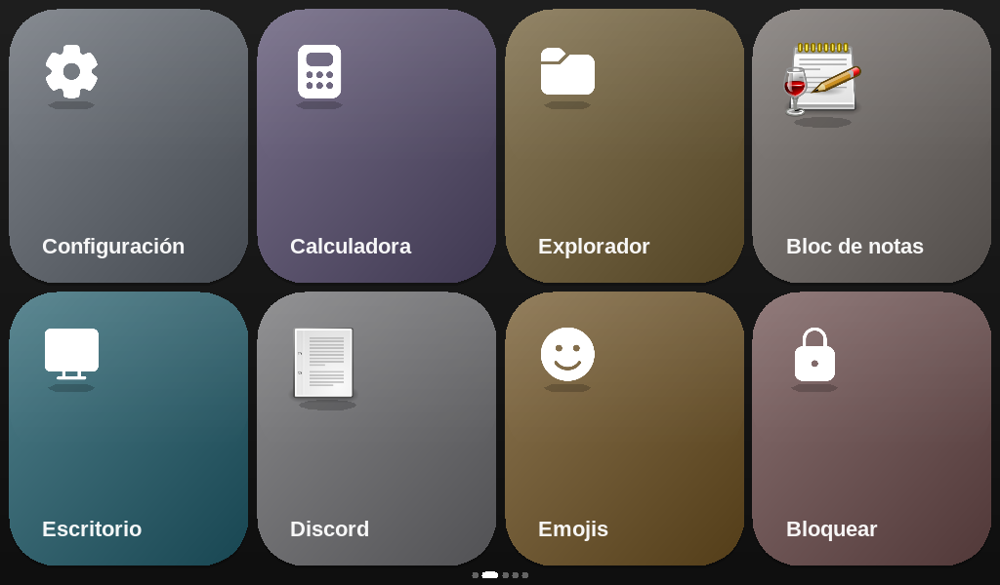
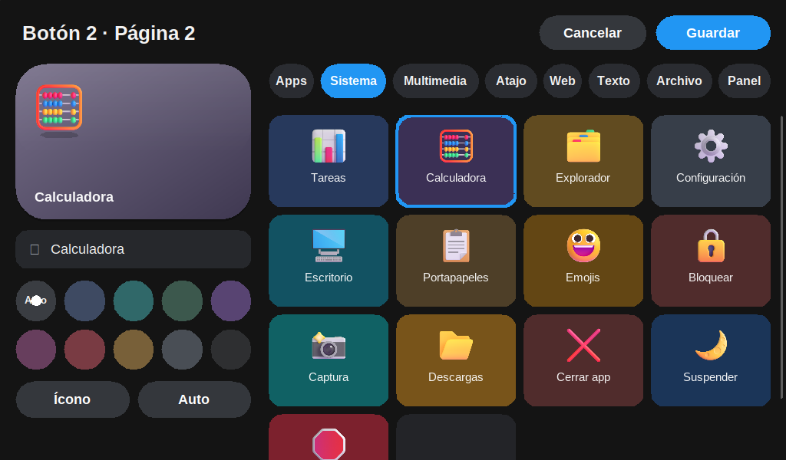
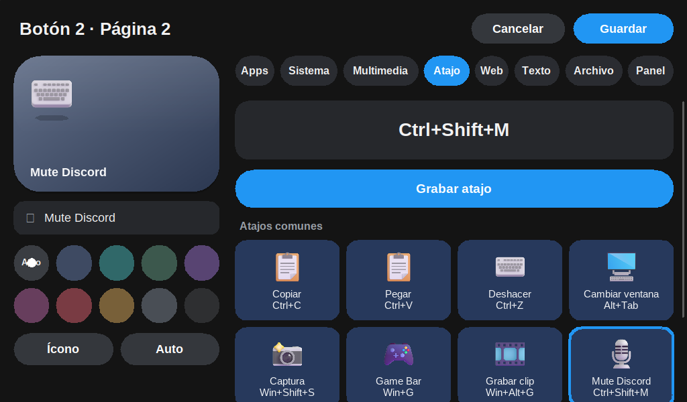

<p align="center">
  
</p>

<h1 align="center">TapBoard</h1>

<p align="center">
  Panel táctil para un mini monitor en Windows: audio, multimedia, atajos y apps a un toque,<br>
  sin robar el foco ni mover el cursor.
</p>

<p align="center">
  <a href="../../releases/latest"><b>⬇ Descargar la última versión</b></a>
</p>

<p align="center">
  
  
</p>

## Qué hace

- **Audio:** cambia la salida entre dispositivos con un toque, ajusta el volumen, silencia el micrófono y usa un mezclador por aplicación.
- **Música:** muestra la canción que suena (Spotify o cualquier app compatible con los controles multimedia de Windows), con carátula, controles y una barra que sirve para adelantar o retroceder.
- **WhatsApp:** muestra en el panel las notificaciones de WhatsApp Desktop. Se descartan deslizando el dedo y quedan guardadas en un historial sin duplicados.
- **Páginas de botones:** puedes tener varias páginas y pasar de una a otra deslizando.
- **Editor de botones al estilo Stream Deck:** un botón puede abrir una app, una acción del sistema, un control multimedia, un atajo de teclado (que se graba al pulsarlo), una URL, un texto que se escribe solo, un archivo o carpeta, o saltar a otra página.
- **Monitor del PC:** CPU, RAM, GPU, temperaturas y red.
- **Temas y reposo:** varios temas, un modo de reposo con reloj, y sonidos y animaciones sutiles al tocar.
- **Actualizaciones:** avisa en el panel cuando hay una versión nueva en GitHub; con un toque la descarga, la instala y se reinicia.
- **Sin foco:** la ventana nunca se activa, así que se puede usar mientras juegas o escribes.

<p align="center">
  
  
</p>

## Instalación

1. Descarga `TapBoard.exe` desde [Releases](../../releases/latest).
2. Ponlo en una carpeta tuya que no sea de sistema (por ejemplo `C:\Users\<tú>\TapBoard\`) y ábrelo. Evita `Program Files`, porque ahí la app no puede actualizarse sola.
3. Desde el engranaje ⚙ puedes elegir el monitor, activar el inicio con Windows y entrar a la configuración.

La configuración se guarda en `%APPDATA%\TapBoard\config.json`. Desde la versión 2.1.0 la app se actualiza sola (Configuración → Sistema).

## Compilar

Solo usa la biblioteca estándar de Go, sin dependencias externas ni CGO. Se puede compilar desde Windows, Linux o macOS:

```bash
GOOS=windows GOARCH=amd64 go build -ldflags "-H windowsgui -s -w" -o TapBoard.exe .
```

En PowerShell:

```powershell
$env:GOOS="windows"; $env:GOARCH="amd64"; go build -ldflags "-H windowsgui -s -w" -o TapBoard.exe .
```

El ícono y la información de versión ya vienen compilados en `rsrc_windows_amd64.syso`. Si cambias `brand/tapboard.rc`, regenéralo con:

```bash
windres -O coff -o rsrc_windows_amd64.syso brand/tapboard.rc
```

## Publicar una versión

1. Sube el número en `version.go` (`appVersion`) y en `brand/tapboard.rc`.
2. Crea un tag `vX.Y.Z` y súbelo, o ejecuta a mano el workflow **Release** desde la pestaña *Actions*.

GitHub Actions compila el `.exe` y lo publica en Releases.

## Estructura

| Archivo | Contenido |
|---|---|
| `app.go` | Ventana, layout, entrada táctil y página principal |
| `editor.go` | Editor de botones (Stream Deck) |
| `apps.go` | Tipos de botón, acciones y lanzamiento de apps |
| `settings.go` | Configuración dentro del panel |
| `media.go` / `spotify.go` | Now playing (GSMTC) |
| `audio.go` / `mixer.go` | Core Audio: dispositivos y mezclador |
| `live.go` / `wpn.go` / `sqlite.go` | Notificaciones de WhatsApp |
| `pcmon.go` | Monitor del PC (PDH / NVML) |
| `style.go` / `theme.go` / `cache.go` | Estilos, temas y caché de renderizado GDI+ |

## Licencia

MIT. Los íconos son [Fluent Emoji](https://github.com/microsoft/fluentui-emoji) de Microsoft, también con licencia MIT.
